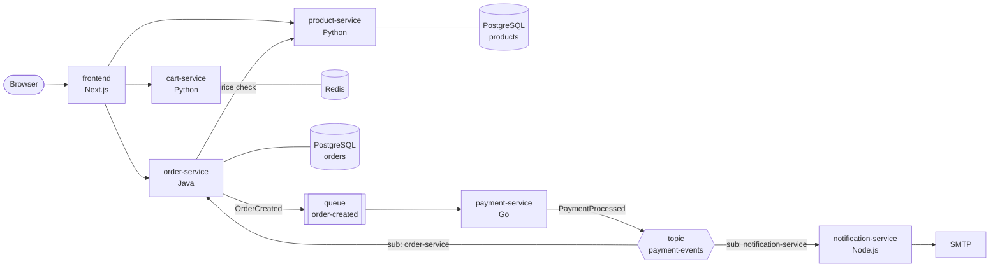
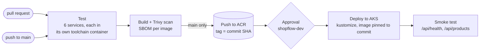

# ShopFlow


An event-driven microservices store, built as the application layer of an enterprise
platform on **Azure**: private AKS, Terraform landing zone, Azure DevOps pipelines, GitOps,
policy-as-code and full observability.

This repository holds the **application**: six services in five languages, plus a local stack
that runs the whole system on a laptop, including Azure Service Bus (through the official emulator).

> **Status:** Phases 1–5 of 10 complete. See the [roadmap](#roadmap). Infrastructure lives in [shopflow-infra](https://github.com/kirthikesh/shopflow-infra).

---

## Architecture



### How an order flows

1. The browser calls the **frontend**, which forwards to internal services. The browser never reaches them directly.
2. **order-service** re-prices every line from **product-service**, ignoring any price from the client, saves the order as `PENDING_PAYMENT` and publishes `OrderCreated` to a **queue**.
3. **payment-service** consumes the queue, approves or declines, and publishes `PaymentProcessed` to a **topic**.
4. The topic fans out to two **subscriptions**:
   - **order-service** marks the order `PAID` or `PAYMENT_FAILED`
   - **notification-service** emails the customer
5. The order page polls until the status changes.

## Services

| Service | Stack | Data | Port |
|---|---|---|---|
| `frontend` | Next.js 16, React 19, TypeScript | — | 3000 |
| `product-service` | Python, FastAPI, SQLAlchemy | PostgreSQL | 8001 |
| `cart-service` | Python, FastAPI | Redis (TTL 7 days) | 8002 |
| `order-service` | Java 21, Spring Boot, JPA, Flyway | PostgreSQL | 8080 |
| `payment-service` | Go, `azservicebus` | — | 8083 |
| `notification-service` | Node.js, Express, Nodemailer | — | 8084 |

Every service exposes `/health` (liveness), `/ready` (readiness)¹ and `/metrics` (Prometheus).
They run as non-root users in multi-stage Docker images.

<sub>¹ Spring Boot uses `/health/liveness` and `/health/readiness`.</sub>

## Run it locally

Needs Docker Desktop with **at least 6 GB of memory** (the SQL Server behind the Service Bus emulator is heavy).

```bash
make up        # build and start everything
```

| | |
|---|---|
| Shop | http://localhost:3000 |
| Email inbox (Mailpit) | http://localhost:8025 |

The Service Bus emulator needs about a minute to start; the consumers retry until it's ready.

**Try a failed payment:** check out with an email containing `+decline`, e.g. `me+decline@example.com`.
Orders over €2,000 are also declined.

```bash
make logs      # follow the app logs
make down      # stop (keeps data)
make clean     # stop and delete all data
```

## Tests

Tests run inside containers, so no local Python, Java, Go or Node install is needed:

```bash
make test               # everything
make test-order         # one service
```

## CI/CD

[`azure-pipelines.yml`](azure-pipelines.yml) runs in Azure DevOps on a self-hosted agent inside the
Azure hub network, and signs in to Azure as that VM's managed identity. No Azure credential is stored
in Azure DevOps.



| Stage | What it checks |
|---|---|
| Test | ruff and pytest (Python), Maven tests (Java), `go vet` and `go test`, Node tests, Next.js type check and production build |
| Build | Each image is scanned with Trivy. The build **fails on any CRITICAL vulnerability that has a fix**; every HIGH and CRITICAL finding is published to the Tests tab, and a CycloneDX SBOM per image is kept as a build artifact |
| Push | Only from `main`. Pull requests build and scan but never publish an image |
| Deploy | Waits for approval on the `shopflow-dev` environment. Skipped automatically when the cluster is switched off to save money |
| Smoke test | Waits for the public IP, then calls the shop's health endpoint and product API through the real load balancer |

Templates live in [`.azure-pipelines/templates`](.azure-pipelines/templates): one for the
managed-identity sign-in and one for build, scan, SBOM and push, reused for all six services.

## Design decisions

- **Database per service.** The product and order services each own a database; nothing reads another service's tables.
- **Server-side pricing.** The cart stores quantities only. The order service fetches prices itself, so a client can't change what it pays.
- **Money in integer cents.** No floating-point rounding anywhere.
- **Queue for commands, topic for events.** `OrderCreated` has one consumer, so it uses a queue. `PaymentProcessed` has two, so it uses a topic with a subscription each.
- **Idempotent consumers.** Stable message IDs with duplicate detection on, and a settled order never changes status on redelivery.
- **Dead-lettering.** Malformed messages go straight to the dead-letter queue; transient failures are retried up to 5 times first.

## Repository layout

```
shopflow-app/
├── azure-pipelines.yml       CI/CD (Azure DevOps)
├── .azure-pipelines/templates/
├── docker-compose.yml        local stack
├── Makefile                  make up / test / deploy
├── deploy/k8s/               Kustomize base and dev overlay
├── local/
│   ├── postgres/init.sql     creates one database per service
│   └── servicebus/config.json  queue, topic and subscriptions for the emulator
└── services/
    ├── frontend/
    ├── product-service/
    ├── cart-service/
    ├── order-service/
    ├── payment-service/
    └── notification-service/
```

Related repositories:
- [`shopflow-infra`](https://github.com/kirthikesh/shopflow-infra): Terraform landing zone, Ansible, infrastructure pipeline
- `shopflow-gitops` (Phase 6): Helm charts and environment config

## Roadmap

- [x] **Phase 1:** Six services, Dockerfiles, local stack with the Service Bus emulator
- [x] **Phase 2:** Terraform landing zone: hub-spoke network, private DNS, remote state, guardrails
- [x] **Phase 3:** AKS with Workload Identity, Cilium and Entra ID RBAC; Kustomize manifests; real Service Bus
- [x] **Phase 4:** Ansible: hardened jump box and self-hosted Azure DevOps agent
- [x] **Phase 5:** Azure DevOps pipelines: templates, Trivy scanning, SBOMs, approvals, managed-identity auth
- [ ] Still to come from Phases 3–5: private API server, ingress with cert-manager, image signing
- [ ] **Phase 6:** GitOps CD: multiple environments, canary releases
- [ ] **Phase 7:** Security: Key Vault, Kyverno, Defender for Containers, Azure Policy
- [ ] **Phase 8:** Observability: OpenTelemetry tracing, Grafana, SLOs, alerting
- [ ] **Phase 9:** Resilience: KEDA, k6 load tests, chaos testing, Velero DR
- [ ] **Phase 10:** Write-up and demo

Known follow-ups: a transactional outbox in the order service, and stock reservation as a saga.
